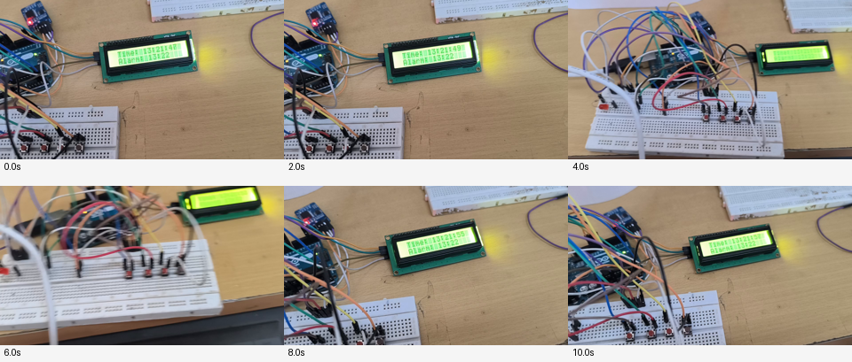
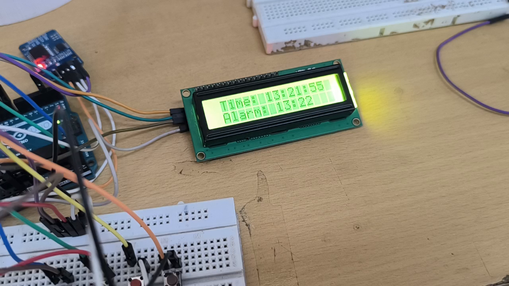
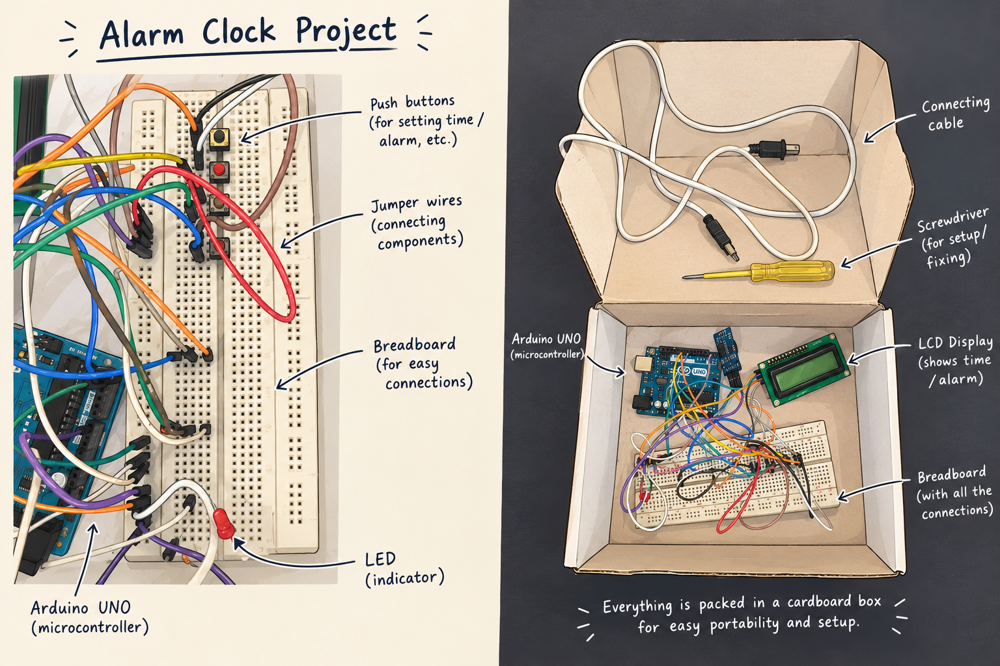

# Arduino-Based Digital Alarm Clock

A digital alarm clock built using Arduino Uno, a DS3231 Real-Time Clock (RTC), a 16x2 I2C LCD, four push buttons, and an LED.

## Features

- Displays the current time.
- Allows the user to set alarm hours and minutes.
- Enables and disables the alarm.
- Flashes an LED when the alarm triggers.

## Components Required

- Arduino Uno
- DS3231 RTC module
- 16x2 I2C LCD
- Four push buttons
- LED and 1 kΩ resistor
- Breadboard and jumper wires

## Pin Connections

| Component | Arduino Pin |
|---|---|
| Menu button | D8 |
| Up button | D9 |
| Down button | D10 |
| Alarm toggle button | D11 |
| LED | D2 through 1 kΩ resistor |
| LCD and RTC SDA | A4 |
| LCD and RTC SCL | A5 |

## Software Requirements

- Arduino IDE
- LiquidCrystal_I2C library
- RTClib library

## How It Works

The Arduino reads the current time from the DS3231 RTC and displays it on the LCD. The buttons allow the user to navigate the menu, adjust the alarm time, and enable or disable the alarm. When the configured alarm time matches, the LED flashes for the first 15 seconds of that minute while the main screen is active.

## Project Photos

## Video Demonstration

## Limitations

- The RTC time must already be set correctly.
- The LED alarm works only while the main screen is active.
- The alarm LED flashes for only the first 15 seconds of the matching minute.

## Author

Ankur Deep Konch
